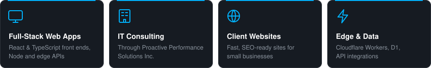
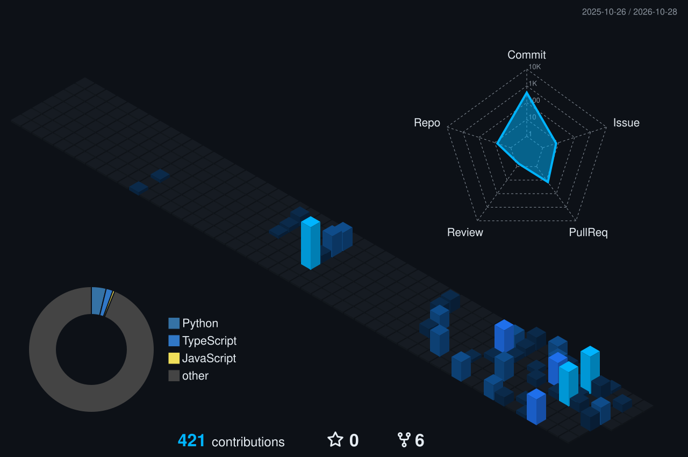

<!-- Profile README for github.com/fredkamm. /assets is hand-made; /metrics, /profile-3d-contrib, /generated and the `output` branch are rebuilt daily by GitHub Actions. -->

<picture>
  <source media="(prefers-color-scheme: dark)" srcset="./assets/hero-dark.svg">
  <source media="(prefers-color-scheme: light)" srcset="./assets/hero-light.svg">
  
</picture>

  
  
  
  
  
  

## ⚡ whoami

<picture>
  <source media="(prefers-color-scheme: dark)" srcset="./assets/whoami-dark.svg">
  <source media="(prefers-color-scheme: light)" srcset="./assets/whoami-light.svg">
  
</picture>

## 🛠 What I do

<picture>
  <source media="(prefers-color-scheme: dark)" srcset="./assets/services-dark.svg">
  <source media="(prefers-color-scheme: light)" srcset="./assets/services-light.svg">
  
</picture>

## 🧰 Skills

<table>
  <tr>
    <td width="33%" valign="top">
      <b>FRONTEND</b>  
      <picture><source media="(prefers-color-scheme: light)" srcset="https://skillicons.dev/icons?i=html,css,js,ts,react,tailwind&perline=6&theme=light"></picture>
    </td>
    <td width="33%" valign="top">
      <b>BACKEND</b>  
      <picture><source media="(prefers-color-scheme: light)" srcset="https://skillicons.dev/icons?i=nodejs,express,graphql,dotnet&perline=6&theme=light"></picture>
    </td>
    <td width="33%" valign="top">
      <b>CLOUD</b>  
      <picture><source media="(prefers-color-scheme: light)" srcset="https://skillicons.dev/icons?i=cloudflare,netlify,vercel&perline=6&theme=light"></picture>
    </td>
  </tr>
  <tr>
    <td valign="top">
      <b>DATA</b>  
      <picture><source media="(prefers-color-scheme: light)" srcset="https://skillicons.dev/icons?i=sqlite,mysql,mongodb&perline=6&theme=light"></picture> 
      
    </td>
    <td valign="top">
      <b>TOOLS</b>  
      <picture><source media="(prefers-color-scheme: light)" srcset="https://skillicons.dev/icons?i=git,githubactions,vscode&perline=6&theme=light"></picture>
    </td>
    <td valign="top">
      <b>AI AGENTS / AUTOMATION</b>  
      
      
    </td>
  </tr>
</table>

## 📊 Metrics

 

## 🏙 Contributions

<picture>
  <source media="(prefers-color-scheme: dark)" srcset="./profile-3d-contrib/profile-blue-dark.svg">
  <source media="(prefers-color-scheme: light)" srcset="./profile-3d-contrib/profile-blue-light.svg">
  
</picture>

<picture>
  <source media="(prefers-color-scheme: dark)" srcset="./generated/activity-dark.svg">
  <source media="(prefers-color-scheme: light)" srcset="./generated/activity-light.svg">
  
</picture>

<picture>
  <source media="(prefers-color-scheme: dark)" srcset="https://raw.githubusercontent.com/fredkamm/fredkamm/output/snake-dark.svg">
  <source media="(prefers-color-scheme: light)" srcset="https://raw.githubusercontent.com/fredkamm/fredkamm/output/snake-light.svg">
  
</picture>
